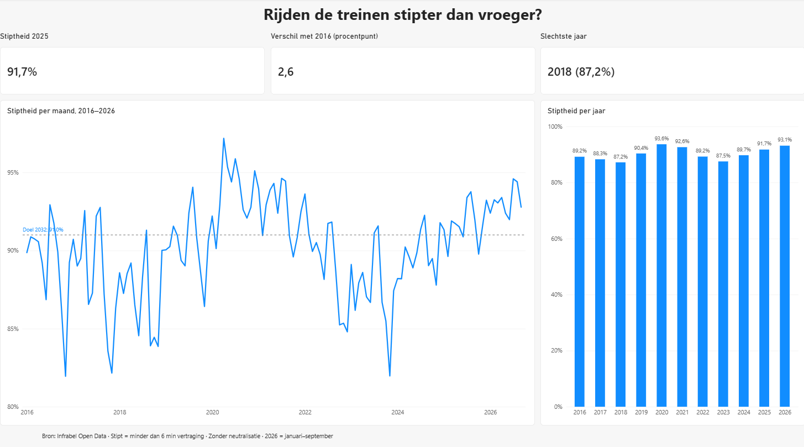

# Stiptheid van Belgische treinen (2016–heden)

## Hoofdvraag
Hoe evolueert de stiptheid van de Belgische reizigerstreinen doorheen de jaren?
Zien we verbetering of verslechtering?

## Deelvragen
- Verschilt de stiptheid per uur van de dag (spits vs. daluren)?
- Verschilt ze per dag van de week?
- Zijn er seizoenspatronen (maand van het jaar)?
- Verschilt ze per treintype (IC, L, P, S)?

## Data & definities
- Bron: Infrabel Open Data
- Een trein is stipt bij minder dan 6 minuten vertraging
- Gebruikte maatstaf: stiptheid **zonder neutralisatie**.
  Infrabel publiceert twee versies van het stiptheidscijfer. In de versie
  *met* neutralisatie tellen sommige vertragingen niet mee, bijvoorbeeld
  door ongevallen aan overwegen, kabeldiefstal, vandalisme of grote werken.
  Die versie meet hoe goed Infrabel en NMBS zelf presteren.
  In de versie *zonder* neutralisatie tellen alle vertragingen mee.
  Omdat dit project wil weten hoe stipt de treinen voor de reiziger zijn,
  gebruik ik deze versie (ook aanbevolen door Infrabel voor een algemeen beeld).

## Afbakening
Dit project beschrijft patronen, maar zoekt niet naar oorzaken
(weer, rollend materieel, drukte).

## Bevindingen
- **Geen rechte lijn omhoog of omlaag.** De stiptheid schommelt tussen
  87 % en 94 % per jaar, met twee dieptepunten: 2018 (87,2 %) en 2023 (87,5 %).
- **Covid als uitschieter.** In 2020 (93,6 %) en 2021 (92,6 %) lag de stiptheid
  hoog, wellicht omdat er minder reizigers en treinen waren. Die jaren zijn
  daarom geen goede maatstaf voor een echte verbetering.
- **Herstel sinds 2023.** Drie jaar op rij beter: 87,5 % → 89,7 % → 91,7 %.
  De eerste negen maanden van 2026 liggen op 93,1 %.
- **Doel bereikt?** 2025 is het eerste jaar buiten de covidjaren dat boven
  de 91 % uitkomt die de overheid tegen 2032 vooropstelt.
- **Seizoenen.** Gemiddeld zijn juli en augustus de stipste maanden,
  november de minst stipte.
- **Controle.** De berekende jaarcijfers voor 2023–2025 komen overeen met
  de cijfers die NMBS zelf publiceerde.

## Conclusie
Over de hele periode is de stiptheid licht verbeterd: +2,6 procentpunt
tussen 2016 en 2025. Belangrijker is de recente trend: na het dieptepunt
van 2023 verbetert de stiptheid drie jaar op rij, en sinds 2025 ligt ze
boven het doel voor 2032.

**Kanttekeningen**
- Afgeschafte treinen tellen niet mee in het stiptheidscijfer.
- Stiptheid wordt alleen gemeten in het eindstation (en Brussel), niet onderweg.
- 2026 bevat alleen januari tot september.

## Tools
Power BI Desktop · Power Query · DAX

## Bestanden
- `stiptheid.pbix`: Power BI-bestand (te openen met Power BI Desktop, gratis)
- `dashboard-trend.png`: screenshot van pagina 1
